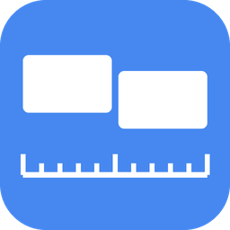
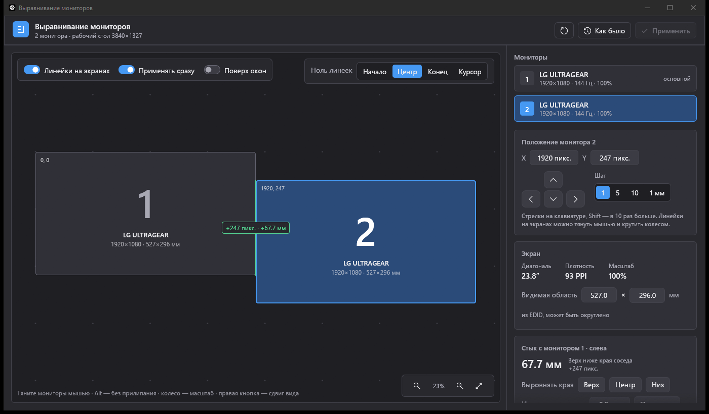
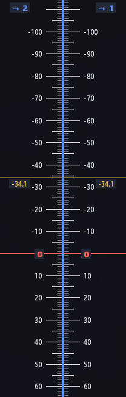

<p align="center">
  
</p>

<h1 align="center">Выравнивание мониторов</h1>

<p align="center">
  Точная подгонка взаимного положения мониторов в Windows,<br>
  с миллиметровыми линейками прямо на стыках экранов.
</p>

<p align="center">
  <a href="https://github.com/hikinokomora/Adjusting-monitors/actions/workflows/build.yml"></a>
  <a href="https://github.com/hikinokomora/Adjusting-monitors/releases/latest"></a>
  <a href="LICENSE"></a>
</p>



Когда мониторы стоят рядом, курсор и окна должны переходить с одного экрана на другой без скачка по высоте. В настройках Windows мониторы двигаются грубо, а разная плотность пикселей не учитывается вообще. Эта программа задаёт положение с точностью до пикселя и рисует на самих экранах линейки, по которым видно, совпадают ли экраны физически.

## Скачать

Готовый `MonitorAligner.exe` лежит в [последнем релизе](https://github.com/hikinokomora/Adjusting-monitors/releases/latest). Установка не нужна, достаточно запустить файл. Работает в Windows 10 и 11.

## Возможности

- **Схема мониторов.** Мониторы можно таскать мышью, они прилипают к краям соседей, с Alt прилипание отключается. Колесо мыши меняет масштаб, правая кнопка двигает вид.
- **Точный сдвиг.** Стрелками на 1, 5, 10 пикселей или примерно на 1 мм, с Shift в 10 раз больше. Координаты можно ввести числом.
- **Линейки на экранах.** Вдоль каждого стыка на самих мониторах рисуются деления через 1 мм с красным нулём и жёлтой отметкой курсора.
- **Линейку можно тянуть.** Монитор сдвигается вслед за ней, сдвиг в пикселях и миллиметрах виден прямо на линейке. Колесо мыши над линейкой сдвигает на 1 пиксель, с Shift на 10.
- **Смещение в миллиметрах.** Для каждого стыка видно, насколько один экран выше или ниже другого. Края можно выровнять одной кнопкой по верху, центру или низу. Можно и ввести смещение, измеренное обычной линейкой, тогда программа рассчитает положение сама.
- **Физический размер экранов.** Берётся из EDID монитора, его можно уточнить вручную, значение запоминается.
- **Применение без мигания.** Раскладка меняется через `SetDisplayConfig`, экраны не гаснут. В режиме «Применять сразу» каждый сдвиг сразу попадает в Windows. Кнопка «Как было» возвращает раскладку на момент запуска.

<p align="center">
  
</p>

## Как пользоваться

1. Запустите программу, проверьте, что включено «Линейки на экранах».
2. Проверьте размер видимой области экранов в миллиметрах. EDID часто округляет его до сантиметра, для точности измерьте рулеткой и введите.
3. Выберите монитор и двигайте его стрелками или тяните саму линейку на экране, пока деления с одинаковыми числами по обе стороны стыка не окажутся на одной высоте. Удобно включить «Применять сразу».
4. Пока линейки включены, сквозь них нельзя кликнуть. Когда всё выставлено, выключите их переключателем.

## Как это устроено

Windows хранит положение мониторов в пикселях, а курсор при переходе через стык сохраняет координату в пикселях. Если у мониторов одинаковая плотность пикселей, достаточно совместить экраны в одной точке, и стык будет ровным по всей длине. Если плотность разная, например 27″ 1440p рядом с 24″ 1080p, ровно совпасть можно только в одной точке, а к концам стыка расхождение растёт.

Поэтому деления на линейках отсчитываются в миллиметрах от общего нуля, отдельно по плотности каждого монитора. Деления совпадают физически тогда и только тогда, когда курсор в точке нуля проходит без скачка. Где стоит ноль, выбирается в «Ноль линеек»: начало, центр или конец стыка, либо точка под курсором. Программа показывает, какое расхождение получится на концах стыка.

## Сборка

Нужен Rust (stable) с MSVC.

```bash
cargo build --release
```

Готовый файл: `target\release\monitor-aligner.exe`.

Настройки хранятся в `%APPDATA%\MonitorAligner\config.json`.

## Лицензия

[MIT](LICENSE)
